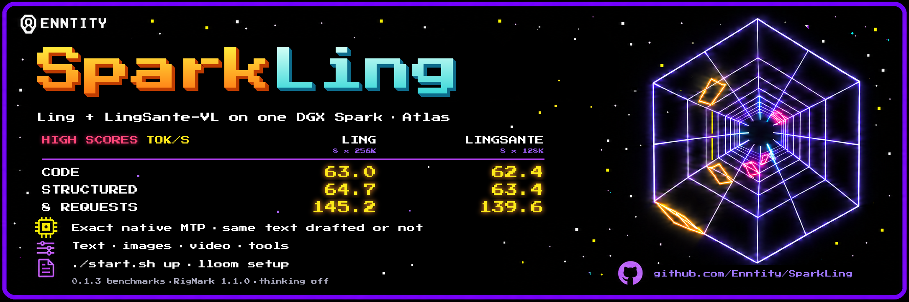

<!-- SPDX-License-Identifier: AGPL-3.0-only -->
<p align="center">
  
</p>

# SparkLing

**SparkLing 0.1.0-dev** serves inclusionAI’s Ling-3.2-air on one NVIDIA DGX Spark. The Atlas engine provides an OpenAI-compatible API for text, images and tool calls. Strict mode serves the original FP8 model. Spark mode uses Primitive AI’s NVFP4A16 checkpoint. [Original model](https://huggingface.co/inclusionAI/Ling-3.2-air) · [Primitive AI checkpoint](https://huggingface.co/primitive-ai/Ling-3.2-air-NVFP4A16)

## RigMark on one Spark

At 40K context with drafting off on both engines, SparkLing’s fast Spark profile decoded prose at **43.70 tok/s**, 2.02× vLLM. Both engines finished both prompts. The two answers took **38.3 and 30.5 seconds** on SparkLing and **65.8 and 64.3 seconds** on vLLM. SparkLing led with four prose clients. At eight clients vLLM served more tokens per second.

| November 23, 2026 · one GB10 | SparkLing (Spark mode) | vLLM |
| --- | ---: | ---: |
| Single-stream prose, tok/s | **43.70** | 21.60 |
| Single-stream structured output, tok/s | **44.09** | 21.61 |
| Four prose clients, aggregate tok/s | **83.78** | 78.80 |
| Eight prose clients, aggregate tok/s | 115.35 | **123.22** |
| Eight code clients, aggregate tok/s | 132.54 | **134.33** |
| 8K prompt, time to first token (cold / exact replay) | **2.38 s / 11.7 ms** | 3.17 s / 247.8 ms |
| 32K prompt, time to first token (cold / exact replay) | **12.00 s / 13.5 ms** | 14.66 s / 287.5 ms |
| Completed prompts, prose / structured / code | 2 of 2 / 2 of 2 / 0 of 2 | 2 of 2 / 2 of 2 / 0 of 2 |

Both engines used the same physical Spark, Primitive AI checkpoint, 40,960-token context and BF16 KV cache, with speculation off. SparkLing used the fast profile below with its BF16 output head. The stock prose suite supplies the single-stream and concurrent prose results. Eight-client code and the first cold/replay pair at each depth come from matched follow-ups.

With thinking enabled, both engines spent all 4,096 tokens on reasoning for each standard code prompt. With thinking disabled on the same Go task, both produced visible code, at **42.85 tok/s** on SparkLing and **21.55 tok/s** on vLLM. RigMark checks visible completion here. Compilation was outside the test. [Measurements and completion counts](results/2026-11-23/bf16-head-qualification.json) · [Full results](results/README.md) · [Prefill and decode rooflines](results/2026-11-23/roofline.md)

## Strict and Spark modes

Ling-3.2-air is a **124B mixture-of-experts model with 5.5B parameters active per token**. After two dense layers, each of the next 40 layers selects eight of 512 routed experts and also runs a shared expert.

| | Strict (default) | Spark |
| --- | --- | --- |
| Checkpoint | inclusionAI’s original dynamic FP8, including its BF16 and FP32 exceptions | Primitive AI’s NVFP4A16 routed experts with BF16 activations |
| Weight storage | 120.4 GiB in 13 shards. Atlas pages cold experts from disk. | About 72.5 GiB |
| Measured configuration | Published weights, chat template and sampling defaults | NVFP4 expert activations for large prompt batches, NVFP4 attention for small batches, published BF16 vocabulary head |
| One-Spark verification | Arithmetic matched SGLang. Atlas also recognized a red image and called the weather tool with Paris. | RigMark results above. Eight concurrent lookup answers matched their serial runs. |

Strict shares one BF16 KV pool between requests, leaving unified memory available to cache expert pages. Its published comparison with SGLang covers serving correctness. [Strict serving receipt](results/gb10-strict-serving.json) · [GB10 kernel checks](results/gb10-operators.json)

## Model selection and context

| Launcher model | Strict (default) | Spark | Default context, prompt and output combined |
| --- | --- | --- | ---: |
| `ling-3.2-air` (default) | inclusionAI dynamic FP8 | Primitive AI NVFP4A16 | 262,144 tokens |
| `sante-air-vl` | inclusionAI original BF16, 232.55 GiB | inclusionAI MXFP4, 64.79 GiB | 131,072 tokens |

Ling-3.2-air uses its **262,144-token window** in the default and max profiles. The pool is shared across clients. Seven full-attention layers take 28.44 GiB of BF16 KV for one full sequence. Atlas stores the 64 rotary-key channels shared by the heads once per token. At 256K, Spark mode reads some upper-layer expert weights from the model files. Saver uses 8,192 tokens. `PROFILE=rigmark-40k` reproduces the earlier 40,960-token benchmark setting.

On one Spark, the model recalled a key from the beginning of a 262,132-token prompt with 12 tokens reserved for the answer. It returned `MARIGOLD` in 8m 3s, including prefill. The first 480 prompt tokens came from the short control’s cache. [256K retrieval result](results/2026-11-24/base-window-long.json)

Air-VL also has a 42-layer language backbone and a vision tower. Its checkpoint omits the appended native predictor that Ling-3.2-air ships. Its config specifies 128K natively. Its publisher’s extended 256K configuration uses YaRN. Air-VL’s Spark mode reads the publisher’s MXFP4 expert weights and E8M0 scales directly. Strict pages the original BF16 expert matrices from the checkpoint. Both modes use Air-VL’s own tokenizer, chat template, processor and served API name `lingsante-air-vl`. [Medical checkpoint](https://huggingface.co/inclusionAI/LingSante-3.1-air-VL) · [Publisher MXFP4 release](https://huggingface.co/inclusionAI/LingSante-3.1-air-VL-MXFP4)

Atlas now serves the publisher’s MXFP4 at **30.26–30.31 tok/s** on the same 64-token counting probe that previously ran at 10.47–10.48. The pinned SGLang reference measured 27.59–28.37. Both engines returned `391` for 17 × 23 and identified a blue square. Strict passed both checks on the original BF16 checkpoint.

SparkLing can also build **NVFP4 directly from inclusionAI’s BF16**. The 70.88 GiB derivative packs the 61,440 routed expert matrices in groups of 16 and retains the original non-expert weights. At runtime, the optional fast settings also quantize attention, shared and dense MLP projections, and the vocabulary head. On the short counting probe the BF16-head fast profile measured **43.94–43.98 tok/s**. With NVFP4 MLPs and vocabulary head it measured **54.07–54.98 tok/s**. These are single-stream, 4K-context decision runs. [Original measurements](results/2026-11-24/README.md) · [Updated Air-VL measurements](results/2026-11-24/air-vl-quant)

```sh
./start.sh --model sante-air-vl --mode spark up
# Convert the pinned BF16 original locally, then serve the fast NVFP4 profile
PREFILL_PRECISION=nvfp4 DECODE_PRECISION=nvfp4-mlp-head ./start.sh --model sante-air-vl --mode spark --quant nvfp4 up
# Serve the publisher's original BF16
./start.sh --model sante-air-vl --mode strict up
```

## Quick start

On a DGX Spark with Docker and NVIDIA GPU access, clone the repo and launch Strict. The first start downloads and verifies the selected checkpoint, then pulls or builds the pinned Atlas image.

```sh
git clone https://github.com/Enntity/SparkLing.git
cd SparkLing
./start.sh --mode strict up
```

To run the **40K Spark profile measured above**, use

```sh
PROFILE=rigmark-40k PREFILL_PRECISION=nvfp4 DECODE_PRECISION=nvfp4 ./start.sh --mode spark up
```

The endpoint is `http://127.0.0.1:8897/v1`. For a short text request:

```sh
curl -sS http://127.0.0.1:8897/v1/chat/completions \
  -H 'Content-Type: application/json' \
  -d '{"model":"ling-3.2-air-atlas","messages":[{"role":"user","content":"What is 17 times 23?"}],"max_tokens":32,"chat_template_kwargs":{"enable_thinking":false}}'
```

Use `./start.sh status`, `./start.sh logs` and `./start.sh stop` to manage the server. `./start.sh --version` prints the product version and exact Atlas revision. To stage a checkpoint before launch, run `./start.sh --mode strict download` and `./start.sh --mode strict verify`, substituting `spark` for the other checkpoint. Each snapshot has its own immutable revision under `MODEL_ROOT` (default `~/models/sparkling`). Allow space for both if you download both.

The default Strict 256K configuration pages experts to fit one Spark. Its 37-token arithmetic smoke took 62.5 s to first token and four output tokens averaged 1.08 tok/s. The 256K Spark retrieval control took 41.5 s to first token on a 512-token prompt. The 40K RigMark and 4K drafting runs use different memory profiles. [Strict smoke](results/2026-11-24/strict-base-window-smoke.json) · [Spark retrieval control](results/2026-11-24/base-window-short.json)

## Native drafting on Ling-3.2-air

Set `DRAFTER=mtp` to use the checkpoint’s one-token predictor. Atlas gives the predictor private attention state and verifies each proposal with the target. In Spark mode only the drafter gets a separate NVFP4 vocabulary head when the target uses its BF16 head. Ordinary decoding is the default. On short greedy requests the batched verifier can choose a different continuation from the single-row target. The 256K retrieval check and 40K RigMark table above used ordinary decode.

```sh
DRAFTER=mtp PROFILE=rigmark-40k PREFILL_PRECISION=nvfp4 DECODE_PRECISION=nvfp4 ./start.sh --mode spark up
```

## Precision and caching

By default, `--mode spark` follows the checkpoint’s activation and attention precision. `PREFILL_PRECISION=nvfp4` quantizes routed expert activations for large prompt batches and uses an 8,192-token prompt chunk in the bundled profiles. Single-token expert decode retains BF16 activations. `DECODE_PRECISION=nvfp4` quantizes the large attention projections at load time. Atlas uses these copies for up to eight rows, including short prompt tails, and the published BF16 weights for larger passes.

The experimental `DECODE_PRECISION=nvfp4-head` also quantizes the vocabulary head. It reached 46.87 tok/s on single-stream prose, but finished only one of two prompts. Keep `DECODE_PRECISION=nvfp4` for the BF16 head used above. Optional disk prefix caches use distinct directories for each precision. The default, saver and max memory profiles are development settings. Strict uses the published sampling settings. Spark uses Atlas sampling defaults unless the request overrides them. The launcher enables the streaming tool guard by default. A filtered response can end with `content_filter`. [Launcher settings](.env.example) · [Experimental head results](results/2026-11-23/one-spark-qualification.json)

## Reproduce the results

Run the pinned RigMark code and prose suites against each engine in turn on the same Spark. Match the checkpoint, generation limits, context and cache settings. The reference launcher pins the vLLM image for Spark mode. The Strict comparison uses the original FP8 checkpoint with SGLang. [Benchmark instructions](docs/REPRODUCE.md) · [Suite and functional checks](bench/README.md) · [Reference launchers](reference/README.md)

## Engine and license

SparkLing contains the launcher, profiles and benchmarks. The implementation lives in Atlas. The install manifest pins the exact engine commit and source tree. SparkLing and Atlas use AGPL-3.0-only. Both model publishers license their weights under MIT. [Atlas PR #411](https://github.com/Atlas-Inf/atlas/pull/411) · [Engine pin](install/atlas-source.json) · [License](LICENSE) · [Notices](NOTICE)
