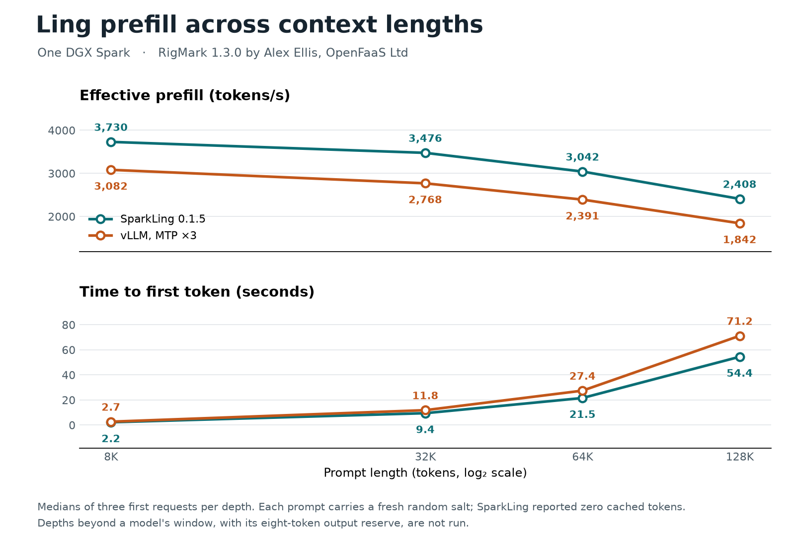

<!-- SPDX-License-Identifier: AGPL-3.0-only -->
<p align="center">
  
</p>

# SparkLing

**SparkLing 0.1.5** serves inclusionAI’s **Ling-3.2-air** and **LingSante-3.1-air-VL** on one NVIDIA DGX Spark, each at its full native context: 262,144 tokens for Ling-3.2-air and 131,072 for LingSante-3.1-air-VL, eight requests at a time from one shared cache. The Atlas engine provides an OpenAI-compatible API for text, images, video and tool calls. In its default Spark mode, SparkLing drafts with each model’s native next-token predictor across up to eight concurrent requests, including inside `<think>` blocks. Every draft is verified with the same arithmetic as plain decoding, so one request’s greedy output is byte-for-byte identical with drafting on or off.

```sh
git clone https://github.com/Enntity/SparkLing.git
cd SparkLing
./start.sh up                                # Ling-3.2-air, Spark mode
./start.sh --model lingsante-3.1-air-vl up   # LingSante-3.1-air-VL, Spark mode
```

The endpoint is `http://127.0.0.1:8897/v1`. The first start downloads and verifies the pinned checkpoint, then pulls the pinned image `ghcr.io/enntity/atlas-sparkling`.

[LLooM](https://github.com/Enntity/lloom) installs either model as a managed runtime behind its gateway, from the same pinned image and weights:

```sh
lloom setup --recipe linux-nvidia-dgx-spark-ling32-air-atlas --additive --apply --yes
lloom setup --recipe linux-nvidia-dgx-spark-lingsante-air-vl-atlas --additive --apply --yes
lloom resume lingsante-3.1-air-vl-atlas --apply --yes   # start it
```

Both recipes were installed and started this way on a DGX Spark on November 25, 2026. The models serve as `ling-3.2-air-atlas` and `lingsante-3.1-air-vl-atlas`. Only one runs at a time, because each needs most of the Spark’s memory.

## LingSante demo

[demo/lingsante](demo/lingsante/README.md) is a one-page demo that calls LingSante live; every patient in it is synthetic. In the run recorded on SparkLing 0.1.4, on one Spark:

- **Chart review.** It read a six-year chart of 51,349 tokens in 17.4 s (25.4 s on 0.1.3) and named all four planted problems, including a lung nodule never followed up and metformin continued at eGFR 27. A follow-up question about the same chart started answering after 1.4 s, because the chart was still in the cache.
- **Film and labs.** It described a chest radiograph in 3.4 s. Given the radiograph and a lab report together, it filed a structured encounter note as a tool call in 11.7 s.
- **Triage.** It triaged eight emergency patients sent at once, all within 6.7 s.

It is a research demonstration, not medical advice.

> **0.1.5 unlocks drafting inside thinking and chains two drafts at C1.** Up to 0.1.4, Atlas turned speculation off during `<think>` blocks, capped Ling at one draft per step, and stopped drafting above four concurrent requests. 0.1.5 declares Ling's verify bit-exact (re-enabling speculation throughout reasoning), chains two drafts at one request and steps down to one draft for two to eight requests on Ling-3.2-air (`ATLAS_MTP_K_LADDER=1:2,4:1,8:1`, one draft up to eight requests on LingSante), adds ragged batched verify, and closes a 33–127-row MoE dispatch dead zone. On SparkModelBench with thinking on, Ling-3.2-air single-stream decode rises from 49.8 / 49.0 / 54.3 to **66.1 / 57.1 / 67.1 tok/s** (15/15 gates) and LingSante rises from 45.9 / 44.6 / 53.2 to **60.8 / 56.8 / 60.3 tok/s** (code gates 5/5); short-code concurrency rises to **56.5 / 84.4 / 125.8 / 141.5 tok/s** on Ling-3.2-air and **53.4 / 79.5 / 104.3 / 129.4 tok/s** on LingSante. [What changed](results/2026-11-27-0.1.5/README.md#what-changed)

> **0.1.4 prefills long prompts about twice as fast.** Ling's prefill attention now uses a 128-row FlashAttention-2 style kernel (62.5 TFLOP/s on a GB10, 3.5 times the old one), and each 8,192-token chunk expands the cached latent once instead of four times. A first 128K prompt reaches its first token in 54.9 s instead of 107.0 s, and SparkLing now prefills faster than vLLM at every depth, by 1.30x at 128K. Prompts up to one 8,200-token chunk are byte-identical to 0.1.3; longer ones move at rounding level. [What changed](results/2026-11-27-0.1.4/README.md#what-changed-long-prompts-prefill-about-twice-as-fast)

> **0.1.3 drafts for several requests at once.** Up to 0.1.2, SparkLing drafted only while a single request was running. 0.1.3 verifies up to four requests’ drafts in one batched pass and drafts them in one predictor pass. On RigMark, short code runs 28% faster at two requests and 24% faster at four for Ling-3.2-air, and 29% and 22% faster for LingSante-3.1-air-VL. One request’s output is byte-identical to 0.1.2. [What changed](results/2026-11-26-0.1.3/README.md#what-changed-several-requests-draft-together)

> **0.1.2 fixes drafting.** In 0.1.1 the drafter got the wrong input: Ling's predictor layer expects the model's last hidden state after its final normalization, and Atlas passed it before. Verify kept the output exact, but only about 70% of drafts were accepted on every prompt, even counting, where vLLM with the same predictor accepts all of them. 0.1.2 accepts 100% on counting, and single-stream decode rises from 54.8 to 61.0 tok/s for Ling-3.2-air and from 54.2 to 57.5 for LingSante-3.1-air-VL. Output is byte-identical to 0.1.1. [What changed](results/2026-11-26-0.1.2/README.md#what-changed-the-predictors-input)

> **Correction to 0.1.0.** SparkLing 0.1.0 advertised a 131,072-token default shared by eight requests. Its KV pool held 56,352 tokens in total, so it could not serve even one 131,072-token request. Atlas cached Ling’s attention as expanded per-head keys and values, 16.6 KB per token per layer. 0.1.1 caches the model’s 576-value compressed latent instead, 1.15 KB per token per layer, and now holds the full window for every request. [0.1.0’s own cache log](results/2026-11-25-0.1.1/raw/010-ling-spark-kv.log)

## Performance

### SparkModelBench scorecard · v0.1.5 on one Spark

We ran both Ling-3.2-air and LingSante-3.1-air-VL on SparkLing 0.1.5 (Atlas `f9d0ebf95`, `ghcr.io/enntity/atlas-sparkling:0.1.5`) on one DGX Spark on November 27–28, 2026, with the default profile and drafter. The vLLM column is the pinned vLLM nightly with its MTP drafter (three tokens), run on the same Spark on November 26, serving the same Ling-3.2-air NVFP4A16 checkpoint with the full 262,144-token window. SparkModelBench pins Alex Ellis’s RigMark and RigMark Quality and selects the workloads and settings. Alex Ellis and OpenFaaS Ltd publish both under the MIT license. Enntity adds the staggered four-request test. [SparkModelBench](https://github.com/enntity/sparkmodelbench) · [RigMark](https://github.com/alexellis/rigmark) · [RigMark Quality](https://github.com/alexellis/rigmark-quality)

SparkModelBench asks for `reasoning_effort: low`. Ling’s template has no effort levels, so its thinking stays on: most of these tokens are thinking.

| RigMark generation, median tok/s | Ling-3.2-air | LingSante-3.1-air-VL | vLLM, MTP ×3 |
|---|---:|---:|---:|
| Code | **66.15** | 60.78 | 42.47 |
| Prose | **57.10** | 56.77 | 37.70 |
| Structured | **67.14** | 60.32 | 41.87 |
| Completion gates, code / prose / structured | 5/5 · 5/5 · 5/5 | 5/5 · 3/5 · 5/5 | 2/5 · 3/5 · 5/5 |

Generation figures are medians of five runs per workload, up to 8,192 tokens each. A run that reaches the cap fails its gate: vLLM reached it on three code runs and two prose runs, and LingSante on two prose runs. RigMark decodes greedily, yet five runs of one workload range widely in length, and decode slows as the context deepens, so these medians move with output length from run to run.

| RigMark Quality task | Ling-3.2-air | LingSante-3.1-air-VL | vLLM, MTP ×3 |
|---|---|---|---|
| `python-expiry` | Passed, 36.9 s | Passed, 48.0 s | Passed, 31.8 s |
| `go-transfer-ledger` | Timed out at 180 s | Exhausted 8K token cap (173.1 s) | Timed out at 180 s |
| `payment-recovery` | Passed, 17.6 s | Passed, 19.2 s | Passed, 16.9 s |
| `evidence-revisions` | Passed, 7.9 s | Passed, 12.8 s | Passed, 7.1 s |

Each quality task ran once; time includes grading. Ling-3.2-air and vLLM ran with the 180-second budget; LingSante ran with the updated 300-second budget (`bench/sparkmodelbench` at `2b9ce8c`) and finished within time on `go-transfer-ledger` before hitting the per-response 8,192-token cap.

**Staggered C4.** Four roughly 16K-token prompts arrived one second apart, thinking off. All streams on both engines reached 400 output tokens. The median time from the first request to the end of a round was **36.71 seconds** for Ling-3.2-air and **36.61 seconds** for LingSante-3.1-air-VL against 73.30 for vLLM, 2.00x faster. SparkLing prefills all four prompts before it decodes any of them, so each stream’s first token came about 18.2 s after its request. vLLM answered the first request in 6.5 s and the fourth after 57.8 s.



SparkLing prefills a first prompt faster than vLLM at every depth: 1.21x at 8K, 1.26x at 32K, 1.27x at 64K and 1.31x at 128K. LingSante-3.1-air-VL prefills within 0.5% of Ling-3.2-air up to its 131,072-token window (3,712 / 3,468 / 3,042 tok/s at 8K / 32K / 64K). 256K is not run, because the sweep’s 262,144-token prompt plus its output does not fit the window. A prompt sent again starts in 0.014–0.027 s on SparkLing, against 0.7–1.6 s on vLLM.

| RigMark concurrency, short code, aggregate tok/s | 1 | 2 | 4 | 8 |
|---|---:|---:|---:|---:|
| Ling-3.2-air | **56.5** | **84.4** | **125.8** | 141.5 |
| LingSante-3.1-air-VL | 53.4 | 79.5 | 104.3 | 129.4 |
| vLLM, MTP ×3 | 41.5 | 73.1 | 112.2 | **174.3** |

Every one of these 256-token outputs is thinking. With `<think>` speculation unlocked and the MTP ladder active up to eight requests, SparkLing now leads vLLM MTP ×3 at one, two and four requests (1.36x, 1.16x and 1.12x). vLLM still leads at eight requests (1.23x): Atlas prefills the eight short prompts serially (1.38 s vs 0.53 s median TTFT) and its unfused `ling_expert_mma` kernel scales worse than Marlin's fused grouped MoE at 16–32 rows.

[Full scorecard](results/sparkmodelbench-v0.1.5/CARD.md) · [result files](results/sparkmodelbench-v0.1.5/) · [0.1.4 scorecard](results/sparkmodelbench-v0.1.4/CARD.md) · [0.1.3 scorecard](results/sparkmodelbench-v0.1.3/CARD.md)

Earlier historical comparisons (RigMark 1.1.0 thinking-off on 0.1.3 and the eight-prompt llama.cpp comparison from 0.1.2) remain archived in [results/2026-11-26-0.1.3](results/2026-11-26-0.1.3/README.md#rigmark) and [results/2026-11-26-0.1.2](results/2026-11-26-0.1.2/README.md).

## Full context, eight at a time

| Default profile, Spark mode | Ling-3.2-air | LingSante-3.1-air-VL |
| --- | ---: | ---: |
| Context window, tokens | 262,144 | 131,072 |
| Shared KV pool, tokens | 2,148,608 (8.2 windows) | 2,374,592 (18 windows) |

- **Eight full windows.** Eight simultaneous 262,132-token prompts, each with different content and its own key word to recall, all returned the right word. They held 2,097,056 prompt tokens together and finished in 45 minutes. Eight 65,524-token prompts took 279 seconds. [8 × 256K](results/2026-11-25-0.1.1/release/r11-long-8x256k.jsonl) · [8 × 64K](results/2026-11-25-0.1.1/release/r11-long-8x64k.jsonl)
- **Decode at depth.** Measured on 0.1.1 with drafting on, 256 tokens after a prompt of 2K, 32K, 128K and 262K tokens decoded at 44.4, 40.6, 34.9 and 27.9 tok/s. 0.1.0 decoded at 3.2 tok/s at 256K, because the old cache forced it to read some experts from disk. [Depth runs](results/2026-11-25-0.1.1/release/ling-spark-depth.jsonl)

Every Spark* memory lever SparkGLM and SparkQwen use is on by default:

- **Compressed cache.** Each token stores one 576-value latent row per attention layer, and keys and values share it.
- **Memory share.** The default profile uses 0.89 of the GB10’s memory, which holds eight full windows with drafting on and leaves the host about 9 GB. `GPU_MEMORY_UTILIZATION` lowers it. `PROFILE=max` uses 0.95 and sixteen request slots.
- **Disk prefix cache.** Evicted cache blocks and KDA recurrent-state snapshots spill to NVMe, 48 GiB under `MODEL_ROOT/prefix-cache`. A later request that shares a prefix resumes from disk instead of prefilling again. `PREFIX_CACHE_GB=0` turns it off, and it turns itself off if the disk lacks room.
- **Display carveout.** The KV cache borrows the GB10’s 2 GiB display carveout when no other Spark* server holds it. It places whole per-layer buffers there. At eight full windows each of Ling’s seven latent buffers is 2.4 GiB, too large to fit, so the default pool gains nothing from it. Smaller pools, such as the `saver` profile’s, do use it. `DISPLAY_CARVEOUT=0` leaves it to the display.

## Exact native drafting

Ling-3.2-air ships one MTP layer. For a single active request, Atlas chains that layer twice (`--num-drafts=2`) and verifies both drafts together with the current token in one three-row CUDA-graphed pass (64% accept-2, 24% accept-1 = 2.52 tokens per step on typical code/reasoning). From two to eight concurrent requests, `ATLAS_MTP_K_LADDER=1:2,4:1,8:1` steps down to one draft per request verified in one batched pass (supporting both uniform and ragged draft widths), avoiding the extra routed-expert reads a wider verify costs across 512 experts. Every verify row uses serial decode's arithmetic, so drafting stays on inside `<think>` blocks and greedy output matches plain decode.

LingSante-3.1-air-VL has no predictor of its own. In Spark mode it borrows Ling-3.2-air’s layer, downloaded with the model, drafting one token per step up to eight active requests. `DRAFTER=none` turns drafting off for either model.

`bench/draft_decode.py --min-count-accept 0.95` checks that a build’s drafter accepts at least 95% on counting (0.1.5 measures 100.0% on counting and 95.2% on Python code at 73+ tok/s). Chaining a third draft (`--num-drafts=3`) was measured slower (~56.8 tok/s) because third-draft acceptance does not cover the extra verify row on a GB10.

## Quality

The compressed cache changes how attention is computed, so 0.1.1 was checked against 0.1.0 and against independent references. 0.1.2–0.1.5 preserve that decode arithmetic: 0.1.5 passed `draft_decode.py --min-count-accept 0.95` (100% counting, 95.2% code), scored 30/30 arithmetic and 10/10 tool calls on `task_probe.py`, and passed 15/15 RigMark generation gates alongside the 0.1.1 quality checks below.

| GSM8K, first 200 test problems, greedy, thinking off | Ling-3.2-air | LingSante-3.1-air-VL |
| --- | ---: | ---: |
| 0.1.0 | 196 | 193 |
| 0.1.1, as shipped (NVFP4 absorption) | 192 | 192 |
| 0.1.1, BF16 absorption | 193 | 189 |

Builds that differ only in rounding moved by up to four problems, so these differences are within noise.

| Ling-3.2-air next-token distributions against vLLM on the same checkpoint | Top-1 agreement | Mean total variation |
| --- | ---: | ---: |
| Decode, 0.1.0 (772 positions) | 94.2% ± 0.8 | 0.049 ± 0.002 |
| Decode, 0.1.1 as shipped (780 positions) | 95.0% ± 0.8 | 0.050 ± 0.002 |
| Decode, 0.1.1 with BF16 absorption (770 positions) | 94.3% ± 0.8 | 0.050 ± 0.002 |
| Prompt, 0.1.0 (1,183 positions) | 97.4% | 0.036 |
| Prompt, 0.1.1 (1,183 positions) | 97.0% | 0.036 |

The decode rows continue 220 contexts for six greedy tokens and compare each position while the texts still agree. The prompt rows force eight passages of prose, code, JSON, arithmetic, dialogue, Chinese and a list through the engine. On those passages 0.1.0 and 0.1.1 both measure perplexity 3.598, and vLLM 3.613. LingSante-3.1-air-VL, scored against inclusionAI’s original BF16 model on the same 68 forced positions as before, agreed on the top token at 56 of 68 positions in both 0.1.0 and 0.1.1, with the same total variation of 0.090. It returned the same text on all five free continuations. [Quality runs](results/2026-11-25-0.1.1/README.md#quality)

## Models and modes

| `--model` | Spark mode (default) | Strict mode | Context |
| --- | --- | --- | ---: |
| `ling-3.2-air` (default) | Primitive AI NVFP4A16 experts, NVFP4 prefill and attention decode, native drafting | inclusionAI’s original dynamic FP8, checkpoint precision | 262,144 tokens |
| `lingsante-3.1-air-vl` | Enntity NVFP4 from inclusionAI’s BF16, NVFP4 prefill and attention decode, Ling’s drafter | inclusionAI’s original BF16 | 131,072 tokens |

Ling-3.2-air is a 124B mixture-of-experts model with 5.5B parameters active per token. It has 35 KDA linear-attention layers, 7 gated-MLA layers and 512 routed experts, of which 8 are active per token. LingSante-3.1-air-VL is inclusionAI’s medical vision-language model on the same backbone. `./start.sh` and LLooM both serve them as `ling-3.2-air-atlas` and `lingsante-3.1-air-vl-atlas`. Set the model with `--model` or `SPARKLING_MODEL` in `.env`; the earlier `sante-air-vl` and `MODEL=` still work.

**Strict mode** serves the original checkpoints for reference. Ling’s FP8 weights are 120.4 GiB, and Air-VL’s BF16 weights are 232.55 GiB. Neither fits in memory, so Strict pages experts from disk and decodes at about 2 tokens per second. Strict’s KV pool stops at eight full windows (15.8 GB at 262K), so the rest of memory can cache the experts it reads from disk. With no limit the pool took 68 GB and Strict slowed to 0.3 tok/s. Use Spark mode for speed. [Strict runs](results/2026-11-25-0.1.1/README.md#strict-mode)

## Input

- **Text and tools.** Tool calls use Ling’s template and parser. The tool guard is on by default and blocks calls to metadata addresses and calls that send credentials. A blocked call ends the response with `content_filter`. In streamed LingSante responses tested on November 25, a tool call’s arguments arrived in one piece once the call was complete, even with `stream_tool_arguments` set.
- **Images.** Send `image_url` parts as base64 data URIs.
- **Video.** Send `video_url` parts. GIF is decoded in process; MP4, MOV, WebM and AVI are decoded by the ffmpeg in the image.
  - Sampling follows inclusionAI’s processor: at most 2 frames per second and 32 frames, with one frame size chosen from a 4.7-megapixel budget.
  - Requests may be up to 256 MiB. A 90-second 720p H.264 clip is about 47 MB as a data URI and answered in 6.6 s.
- **Checks on one Spark.**
  - A counting clip (the numbers 1 to 8) was read back in order, as GIF and as MP4.
  - A red-to-blue clip, an invoice and a labelled grid were read correctly.
  - [Media checks](results/2026-11-25/raw/video3.jsonl)

## Precision, sampling and caching

In Spark mode, `PREFILL_PRECISION=nvfp4` quantizes routed-expert activations for large prompt batches. `DECODE_PRECISION=nvfp4` quantizes the large attention projections at load time, including the two halves of `kv_b_proj` that decode applies to the compressed cache, and keeps the published BF16 vocabulary head. Set either to `checkpoint` to follow the checkpoint’s own precision. Strict uses the published sampling settings; Spark uses Atlas’s sampling defaults, including min-p 0.08 and top-n-sigma 1.0, unless the request overrides them. The disk prefix cache uses a separate directory for each precision. [Launcher settings](.env.example)

Use `./start.sh status`, `./start.sh logs` and `./start.sh stop` to manage the server, and `./start.sh --version` to print the product version and engine revision. `./start.sh download` and `./start.sh verify` stage a checkpoint ahead of time. Each snapshot has its own immutable revision directory under `MODEL_ROOT` (default `~/models/sparkling`).

## Reproduce

[results/2026-11-27-0.1.5](results/2026-11-27-0.1.5/README.md), [results/2026-11-27-0.1.4](results/2026-11-27-0.1.4/README.md), [results/2026-11-26-0.1.3](results/2026-11-26-0.1.3/README.md), [results/2026-11-26-0.1.2](results/2026-11-26-0.1.2/README.md) and [results/2026-11-25-0.1.1](results/2026-11-25-0.1.1/README.md) list the scripts and commands behind every number above. The reference launchers pin the vLLM and SGLang images. [Benchmark instructions](docs/REPRODUCE.md) · [Functional checks](bench/README.md) · [Reference launchers](reference/README.md) · [Earlier results](results/README.md)

## Engine and license

SparkLing contains the launcher, profiles and benchmarks; the implementation lives in Atlas. The install manifest pins the exact engine commit and source tree. SparkLing and Atlas are AGPL-3.0-only. Ling-3.2-air, LingSante-3.1-air-VL, Primitive AI’s NVFP4A16 and Enntity’s NVFP4 weights are MIT. [Engine pin](install/atlas-source.json) · [Upstream Atlas PR](https://github.com/Atlas-Inf/atlas/pull/411) · [License](LICENSE) · [Notices](NOTICE)
